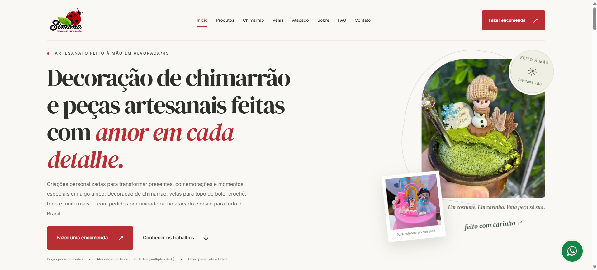

# Simone Decoração e Artesanato

  Landing page profissional desenvolvida para fortalecer a presença digital da
  <strong>Simone Decoração e Artesanato</strong>, artesã localizada em Alvorada/RS.

  <a href="https://assisfilipee.github.io/simone-decoracao-artesanato/">
    <strong>🌐 Ver projeto online</strong>
  </a>

---

## Sobre o projeto

A landing page foi desenvolvida com foco em apresentar de forma profissional o trabalho artesanal da **Simone Decoração e Artesanato**, valorizando a identidade da marca, seus produtos personalizados e facilitando o contato direto com novos clientes.

O projeto destaca principalmente a produção de **decorações personalizadas para chimarrão**, além de velas para topo de bolo, crochê, tricô e outras peças artesanais.

A página também apresenta condições para pedidos no **atacado**, com atendimento a partir de 6 unidades e pedidos em múltiplos de 6.

---

## Objetivos

O projeto foi pensado para:

- fortalecer a presença digital da marca;
- apresentar os produtos de forma profissional;
- destacar a decoração de chimarrão como principal produto;
- gerar contatos e encomendas pelo WhatsApp;
- apresentar opções para varejo e atacado;
- reforçar o atendimento em Alvorada/RS e região;
- comunicar o envio de produtos para todo o Brasil;
- criar uma base preparada para SEO local e presença no Google.

---

## Principais seções

- Hero com apresentação da marca
- Produtos artesanais
- Decoração de chimarrão
- Velas e topos de bolo
- Processo de encomenda
- Atendimento no atacado
- Galeria de trabalhos
- Sobre a artesã
- Dúvidas frequentes
- Atendimento local e nacional
- CTA para WhatsApp
- Footer institucional

---

## Recursos e funcionalidades

- Layout responsivo
- Navegação com header fixo
- Menu mobile
- Scroll suave entre seções
- Animações com JavaScript
- Microinterações
- Galeria de produtos
- Lightbox
- FAQ em accordion
- Botões diretos para WhatsApp
- CTA específico para atacado
- Botão flutuante de WhatsApp
- Botão para retornar ao topo
- SEO básico e SEO local
- Open Graph
- Dados estruturados em JSON-LD
- FAQ Schema
- LocalBusiness Schema
- Acessibilidade com ARIA e navegação por teclado
- Suporte a `prefers-reduced-motion`
- Otimização para dispositivos móveis

---

## Tecnologias utilizadas

  
  
  

O projeto foi desenvolvido sem frameworks, utilizando **HTML5, CSS3 e JavaScript Vanilla**, priorizando performance, simplicidade e facilidade de manutenção.

---

## Responsividade

A interface foi desenvolvida e revisada para diferentes tamanhos de tela:

- Desktop
- Notebook
- Tablet
- Smartphone

Com ajustes específicos de tipografia, espaçamento, navegação, imagens e organização de conteúdo.

---

## SEO Local

A estrutura também foi preparada para buscas relacionadas ao negócio e à localização da cliente, incluindo termos e informações relacionadas a:

- artesanato em Alvorada/RS;
- decoração de chimarrão personalizada;
- velas personalizadas para topo de bolo;
- artesanato personalizado;
- crochê e tricô;
- Porto Alegre e Região Metropolitana;
- envio para todo o Brasil.

---

## Sobre a marca

**Simone Decoração e Artesanato**

📍 Alvorada - Rio Grande do Sul  
📦 Envio para todo o Brasil  
📱 Instagram: [@decorsimone](https://instagram.com/decorsimone)

> **Amor em cada detalhe!**

---

## Projeto online

### [Acessar Simone Decoração e Artesanato →](https://assisfilipee.github.io/simone-decoracao-artesanato/)

---

## Desenvolvido por

**Filipe Assis**

Desenvolvimento de sites, landing pages e presença digital para negócios locais.

🌐 [filipeassis.dev](https://filipeassis.dev/)

---

  Desenvolvido com atenção aos detalhes para transformar o trabalho artesanal em uma presença digital profissional.

